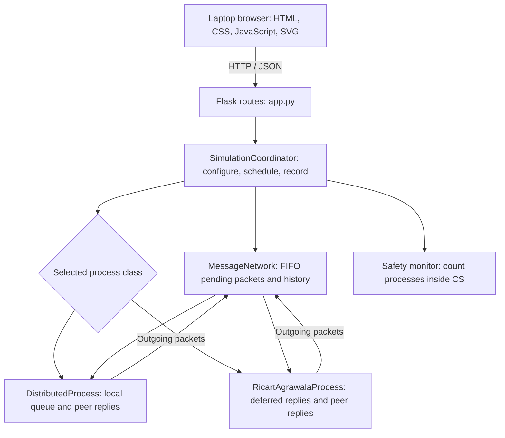

# Distributed Mutual Exclusion Simulator

**Lamport and Ricart–Agrawala, explained through an interactive laptop interface.**

A Distributed Computing practical project for understanding how independent processes coordinate access to one critical section using logical clocks and message passing.

The same interface supports both algorithms: select a protocol, create requests, deliver messages one step at a time, and read an explanation of each state change.

| Item | Details |
| --- | --- |
| Algorithms | Lamport; Ricart–Agrawala |
| Participating processes | 3 to 8, named P1 through P8 |
| Backend | Python, Flask, in-memory simulation |
| Frontend | HTML, CSS, plain JavaScript, SVG |
| Default run | Lamport, 4 processes, 1.2-second auto-step delay, 3 CS ticks, paused |
| Default address | [http://127.0.0.1:5000/](http://127.0.0.1:5000/) |
| Automated tests | 42 test methods across algorithm and API suites |
| Intended use | Learning, college practical demonstrations, and viva preparation |

**Simulation model:** distributed processes are represented by independent Python objects inside one application. Messages travel through an in-memory network. This project demonstrates distributed protocols; it does not start separate operating-system processes or communicate between physical computers.

## Contents

1. [Overview and features](#1-overview-and-features)
2. [Installation and running](#2-installation-and-running)
3. [Interface and controls](#3-interface-and-controls)
4. [Logical clocks and shared concepts](#4-logical-clocks-and-shared-concepts)
5. [Lamport algorithm](#5-lamport-algorithm)
6. [Ricart-Agrawala algorithm](#6-ricart-agrawala-algorithm)
7. [Comparison and message complexity](#7-comparison-and-message-complexity)
8. [Practical demonstration walkthroughs](#8-practical-demonstration-walkthroughs)
9. [Architecture and project structure](#9-architecture-and-project-structure)
10. [REST API](#10-rest-api)
11. [State, messages, and events](#11-state-messages-and-events)
12. [Tests and verification](#12-tests-and-verification)
13. [Troubleshooting](#13-troubleshooting)
14. [Assumptions and limitations](#14-assumptions-and-limitations)
15. [Viva questions and answers](#15-viva-questions-and-answers)
16. [References](#16-references)

## 1. Overview and features

### The problem

Several processes want to use the same resource, but they cannot rely on a shared-memory lock or a globally synchronized clock. They must exchange messages to decide which process can enter the critical section, abbreviated **CS**.

The key safety requirement is:

```text
Number of processes inside CS <= 1
```

Both protocols aim to provide mutual exclusion and progress under their communication and failure assumptions. They use request priority based on logical timestamps and process IDs.

### What the simulator provides

- An **Algorithm** dropdown for switching between Lamport and Ricart–Agrawala.
- Manual requests from individual processes and a concurrent-request demonstration.
- **Next step** and **Start auto / Pause auto** controls.
- A network diagram showing process clocks, states, the shared resource, and the current delivery.
- Live English explanations with the actual clock calculation and next scheduled action.
- A local entry-condition inspector for a selected process.
- Lamport local queues or Ricart–Agrawala deferred-reply lists, depending on the selected algorithm.
- An observer overview of outstanding requests.
- A filterable protocol log with expandable explanations.
- Message history and a six-stage reference for the selected protocol.
- A safety monitor and counters for completed requests and messages sent.

The layout is designed for laptop and desktop demonstrations. It uses readable text, message-type labels, keyboard focus indicators, and reduced-motion support. Mobile-specific layouts are outside the current scope.

## 2. Installation and running

### Prerequisites

- Python with `venv` and `pip`. **Python 3.13 is the verified setup for this workspace.**
- A current laptop or desktop web browser.
- Internet access for the initial Python package installation.

There is no Node.js build step, database setup, account registration, or separate frontend server.

### Windows PowerShell setup

Open PowerShell in the project folder. For the current workspace:

```powershell
cd D:\DC_MINIP\DC_MINIP
```

If your copy is elsewhere, use that folder instead. The selected directory must contain `app.py` and `requirements.txt`.

Create the virtual environment:

```powershell
py -3.13 -m venv .venv
```

If you use another installed Python interpreter, the equivalent command is:

```powershell
python -m venv .venv
```

Install the requirements and start the server:

```powershell
.\.venv\Scripts\python.exe -m pip install -r requirements.txt
.\.venv\Scripts\python.exe app.py
```

Open [http://127.0.0.1:5000/](http://127.0.0.1:5000/) in the browser.

These commands use the environment's interpreter directly, so activating the environment is optional. They also avoid PowerShell script-execution-policy issues with `Activate.ps1`.

### Future runs

After the first installation:

```powershell
cd D:\DC_MINIP\DC_MINIP
.\.venv\Scripts\python.exe app.py
```

Keep the terminal open while using the application. Press **Ctrl+C** in that terminal to stop the server.

### macOS or Linux command equivalents

From the project root:

```bash
python3 -m venv .venv
.venv/bin/python -m pip install -r requirements.txt
.venv/bin/python app.py
```

The current workspace verification was performed on Windows; these are the equivalent environment and launch commands.

### Python dependencies

`requirements.txt` declares:

| Package | Declared version | Purpose |
| --- | --- | --- |
| Flask | `>=3.0.0` | Web application, template rendering, and JSON routes |
| Werkzeug | `>=3.0.0` | HTTP and development-server utilities used by Flask |
| pytest | `>=8.0.0` | Optional test runner for the existing `unittest` suites |

Versions are minimum constraints rather than a pinned lockfile.

### Frontend and offline use

All functional JavaScript, CSS, and SVG rendering are served from this project. Bootstrap and Chart.js are not required. IBM Plex Sans is requested from Google Fonts; local system fonts provide a fallback if it is unavailable.

After dependencies are installed, the simulator can run without an internet connection. An unavailable web font changes the fallback typeface, not the protocol or controls.

## 3. Interface and controls

### Toolbar

| Control | Behaviour |
| --- | --- |
| **Algorithm** | Select Lamport or Ricart–Agrawala. Changing the algorithm clears the run and pauses playback. |
| **Processes** | Choose 3–8 processes. Changing the count clears the run and pauses playback. |
| **Step delay** | Choose 0.6, 1.2, 2, or 3 seconds between automatic iterations. |
| **CS duration** | Choose 1, 2, 3, 5, 8, or 10 simulation ticks for subsequent CS entries. |
| **Concurrent requests** | Request from the first two idle processes. The UI enables this when at least two processes are idle. |
| **Next step** | Deliver one pending message, advance CS work, or perform the resulting exit. Disabled during auto playback. |
| **Start auto / Pause auto** | Start or pause the background simulation. |
| **Reset** | Clear clocks, requests, deferred replies, messages, logs, and counters, then remain paused. |

Algorithm changes and resets preserve the selected process count, delay, and CS duration. A new server process starts with the defaults listed at the top of this README.

**Auto behaviour:** after a brief idle period, the worker picks an idle process at random and creates a request. It then advances the simulation. For repeatable comparisons, use manual steps and reset before each run.

### Status strip

- **Safety holds in this run:** no safety violation has been detected since the last reset.
- **Inside CS:** current occupancy, with a target maximum of one.
- **Completed:** requests whose process has exited CS.
- **Messages sent:** messages added to the simulated network, including messages still pending.
- **Simulation step:** the discrete event/tick counter.

The message counter is not a delivered-message counter. A completed Lamport process can still have RELEASE messages in transit.

### Message flow

The SVG diagram displays the process nodes and shared critical section. Selecting a node inspects that process; it does not create a request. Use **Request resource** on the process card to request access.

The coloured route and caption identify the current delivery. Other messages remain pending until later steps. After an event is processed, the diagram shows the resulting state.

| Colour | Meaning |
| --- | --- |
| Amber | REQUEST messages and requesting processes |
| Blue | REPLY messages, selection, and waiting state |
| Green | A process inside CS; Lamport RELEASE messages |
| Neutral | Idle processes and inactive connections |
| Red | Errors or a detected safety violation |

Text labels accompany the colours. Ricart–Agrawala hides the RELEASE legend and RELEASE log filter because that protocol sends no RELEASE packets.

### Live explanation

The explanation presents:

1. **What happened:** the current request, delivery, entry, progress, or exit.
2. **Why:** the protocol rule and relevant process state.
3. **Clock calculation:** for example, `P2: C = max(1, 1) + 1 = 2`.
4. **What next:** the next pending packet or remaining CS work.

A single step can deliver a message and cause a process to enter CS. In that case, the explanation can show the entry together with the clock update from the delivery that enabled it.

Log filters do not change the current live explanation.

### Local entry inspector

Select a process using its diagram node, its name on the card, or the inspector dropdown.

- **Lamport:** inspect whether its request is first in its own queue and whether every peer has replied.
- **Ricart–Agrawala:** inspect whether every peer has replied to its current request.

The inspector also names missing peers or a request ahead in the local queue. A reply count by itself is insufficient for Lamport entry.

### Process cards

Both modes show the current clock, collected replies, completed requests, and a request button.

| Lamport cards | Ricart–Agrawala cards |
| --- | --- |
| Show the process's local sorted request queue. | Show requests for which this process is holding a reply. |
| Highlight the process's own queue entry. | Show its own fixed request timestamp separately. |
| An entry such as `(1, P2)` is a queued request. | An entry such as `(1, P2)` means this process owes P2 a reply for P2's request at timestamp 1. |

Deferred replies are local bookkeeping, not an extra network message type.

### Observer overview

The overview is a teaching display and grants no permission to enter CS.

- **Lamport:** it combines entries still present in any local queue. **Seen in** lists the queues containing an entry. **Release pending** means the owner has finished, but at least one peer has not processed its RELEASE.
- **Ricart–Agrawala:** it lists active requests and their reply counts. Requests are sorted for display; the protocol does not use this combined list to grant access.

### Protocol log and reference

Filter the log using **All**, **Request**, **Reply**, **Release** in Lamport mode, or **CS**. Expand an event to read its explanation.

Receiving a REQUEST and deciding to defer its reply is recorded as a REQUEST event with a deferral explanation. Receiving a REQUEST and sending an immediate REPLY is also a REQUEST-handling event. A separate REPLY event appears when that reply is delivered.

Open **Message history & algorithm reference** to see packet routes, timestamps, pending/delivered status, the selected algorithm's stages, and its message-complexity formula.

## 4. Logical clocks and shared concepts

### Logical time and request priority

Each process maintains a logical clock `C`, initially zero. In this implementation:

```text
Create a resource request:
    C = C + 1
    Save the request as (C, process_id)

Receive a message stamped T:
    C = max(C, T) + 1

Exit the critical section:
    C = C + 1
    Send the protocol's outgoing messages, if any
```

Replies generated while handling a received REQUEST use the updated receive clock. A broadcast or a batch of deferred replies is produced within one handler action and can share a timestamp.

The **request timestamp stays fixed** while the process waits, even when its current clock advances on later deliveries. Priority comparisons use that saved timestamp.

Requests use lexicographic order:

```text
(T1, PID1) precedes (T2, PID2) when:
    T1 < T2
    OR
    T1 == T2 AND PID1 < PID2
```

Examples:

| Requests | Higher priority | Reason |
| --- | --- | --- |
| `(2, P4)` and `(5, P1)` | `(2, P4)` | Lower timestamp |
| `(3, P1)` and `(3, P2)` | `(3, P1)` | Equal timestamp; lower process ID |

Logical clocks help represent event ordering. Their values are not seconds, and a lower logical timestamp alone does not prove that two independent events have a causal relationship.

### Three different notions of time

| Value | Meaning |
| --- | --- |
| Logical clock | A process-local counter used by the protocols |
| Simulation step | One invocation of the discrete step engine |
| CS ticks | Remaining simulated work while a process occupies CS |

Creating a manual request does not increment the simulation step counter. Multiple requests can therefore be logged at the same step.

Pending messages have priority over CS ticks. If messages are pending while a process is inside CS, the simulator delivers those messages before decrementing its remaining work. This is a scheduling choice for teaching, not a measurement of real distributed execution time.

### Process states

| Internal state | Meaning |
| --- | --- |
| `RELEASED` | Idle, with no active resource request; displayed as **Idle** |
| `REQUESTING` | An active request is waiting for peer replies |
| `WAITING` | The reply handler has collected the required count; Lamport may still be blocked by its queue head |
| `IN_CRITICAL_SECTION` | Executing the simulated critical section |

In Ricart–Agrawala, collecting the last required reply normally leads to CS entry in the same step. The shared state name `RELEASED` does not mean that a RELEASE packet was sent.

## 5. Lamport algorithm

Each process owns a logical clock, a local request queue, a current request, and a set of peer IDs whose replies have arrived.

### Working

1. **Request:** increment the clock, save `(timestamp, PID)`, insert it into the local queue, and broadcast REQUEST to every peer.
2. **Receive REQUEST:** update the clock, insert the sender's request into the local sorted queue, and send a REPLY immediately.
3. **Receive REPLY:** update the clock and record the sender for the matching active request.
4. **Enter CS:** require both the local queue-head condition and replies from every other process.
5. **Exit CS:** remove the process's own request, clear its reply tracker, increment the clock, and broadcast RELEASE.
6. **Receive RELEASE:** update the clock and remove the sender's request from the local queue. Reevaluate entry conditions.

Different local queues may temporarily contain different entries because messages are still in transit.

### Entry condition

```text
active_request exists
AND own request is first in this process's local queue
AND a matching REPLY has arrived from every other process
```

Being first in the observer overview does not establish either local condition.

### Pseudocode

```text
request_resource():
    clock += 1
    own_request = (clock, my_pid)
    insert_sorted(local_queue, own_request)
    replies = empty_set
    state = REQUESTING
    broadcast REQUEST(clock, own_request.timestamp)

on_request(message):
    clock = max(clock, message.timestamp) + 1
    insert_sorted(local_queue, (message.req_timestamp, message.sender))
    send REPLY(clock, message.req_timestamp) to message.sender

on_reply(message):
    clock = max(clock, message.timestamp) + 1
    if message.sender is not me and message matches own_request:
        replies.add(message.sender)
    evaluate_local_entry()

evaluate_local_entry():
    if own_request exists
       and local_queue.head == own_request
       and every peer is in replies:
        enter_critical_section()

on_exit():
    remove own_request from local_queue
    clear own_request and replies
    state = RELEASED
    clock += 1
    broadcast RELEASE(clock)

on_release(message):
    clock = max(clock, message.timestamp) + 1
    remove message.sender's request from local_queue
    evaluate_local_entry()
```

This simulator's normal transport is FIFO. Its local queues are part of the protocol; the observer's combined queue is not.

## 6. Ricart-Agrawala algorithm

Ricart–Agrawala reuses the request/reply approach and logical-clock priority while delaying some replies until exit. It does not maintain Lamport's replicated request queues.

Each process maintains its own current request, collected peer replies, and a map of deferred requests keyed by requester PID.

### The reply decision

When a REQUEST arrives, first update the local clock. Then apply:

| Receiver's situation | Action |
| --- | --- |
| Idle | Send REPLY immediately |
| Inside CS | Defer the reply until exit |
| Requesting, with a smaller own `(timestamp, PID)` | Defer the reply until exit |
| Requesting, with a larger own `(timestamp, PID)` | Send REPLY immediately |

The comparison uses the saved request timestamp, not the receiver's newly updated clock.

### Working

1. **Request:** increment the clock, save the request timestamp, clear prior collected replies, and broadcast REQUEST to every peer.
2. **Receive REQUEST:** reply immediately or save the request in the deferred list according to the table above.
3. **Receive REPLY:** update the clock and record the peer for the matching active request.
4. **Enter CS:** require a REPLY from every other process.
5. **Exit CS:** clear the active request, increment the clock, send the held replies, and empty the deferred list.

There is no RELEASE broadcast. If no replies were held, exit sends no network messages.

### Entry condition

```text
active_request exists
AND a matching REPLY has arrived from every other process
```

There is no additional queue-head check.

### Pseudocode

```text
request_resource():
    clock += 1
    own_request = (clock, my_pid)
    replies = empty_set
    state = REQUESTING
    broadcast REQUEST(clock, own_request.timestamp)

on_request(message):
    clock = max(clock, message.timestamp) + 1
    incoming_request = (message.req_timestamp, message.sender)

    if state == IN_CRITICAL_SECTION
       or (own_request exists and own_request < incoming_request):
        deferred[message.sender] = incoming_request
    else:
        send REPLY(clock, message.req_timestamp) to message.sender

on_reply(message):
    clock = max(clock, message.timestamp) + 1
    if message.sender is not me and message matches own_request:
        replies.add(message.sender)
    if own_request exists and every peer is in replies:
        enter_critical_section()

on_exit():
    clear own_request and replies
    state = RELEASED
    clock += 1
    for each saved request in deferred:
        send REPLY(clock, saved_request.timestamp) to saved_request.pid
    clear deferred
```

The saved timestamp in each outgoing deferred reply identifies the peer's original request. It is separate from the timestamp of the reply message itself.

## 7. Comparison and message complexity

| Property | Lamport | Ricart–Agrawala |
| --- | --- | --- |
| Packet types | REQUEST, REPLY, RELEASE | REQUEST, REPLY |
| Priority | `(request timestamp, PID)` | `(request timestamp, PID)` |
| Local protocol bookkeeping | Sorted request queue and collected replies | Deferred requests and collected replies |
| On receiving REQUEST | Reply immediately | Reply immediately or defer |
| Entry | Own queue head plus all peer replies | All peer replies |
| On exit | Broadcast RELEASE to every peer | Send replies that were deferred |
| Messages per complete request lifecycle | `3(N − 1)` | `2(N − 1)` |
| Crash handling in this project | Not implemented | Not implemented |

For one process's successful request:

```text
Lamport:
    (N − 1) REQUEST + (N − 1) REPLY + (N − 1) RELEASE
    = 3(N − 1)

Ricart–Agrawala:
    (N − 1) REQUEST + (N − 1) REPLY
    = 2(N − 1)
```

Delayed replies are still part of the same `N − 1` replies. Deferral does not add a new packet type or an extra message.

| Processes | Lamport messages per request | Ricart–Agrawala messages per request |
| ---: | ---: | ---: |
| 3 | 6 | 4 |
| 4 | 9 | 6 |
| 5 | 12 | 8 |
| 6 | 15 | 10 |
| 7 | 18 | 12 |
| 8 | 21 | 14 |

These are complete-lifecycle totals under normal reliable delivery. During a run, the sent-message counter can include requests from processes that have not finished. For Lamport, wait for the final RELEASE deliveries if you want every local queue to be empty.

Removing a central permission server does not make these basic protocols crash-tolerant. Both still depend on participating peers responding correctly.

## 8. Practical demonstration walkthroughs

### Preparation for a repeatable comparison

1. Select **4 processes** and **3 CS ticks**.
2. Select the algorithm to demonstrate.
3. Click **Reset** and keep the run paused.
4. Click **Concurrent requests** exactly once. From this clean state, P1 and P2 both request at timestamp 1.
5. Use **Next step**, and inspect P1 or P2 as required.

The milestones below assume this exact setup, normal FIFO delivery, and no additional requests or auto playback.

### Lamport: why all replies are not enough

| Step | What to observe |
| ---: | --- |
| 0 | P1 and P2 have `(1, P1)` and `(1, P2)` requests. Six REQUEST packets have been sent. |
| 6 | All REQUEST packets have arrived and six REPLY packets are pending. |
| 9 | P1 has every peer's reply and enters CS. |
| 12 | P2 also has all three replies, but P1 is ahead in P2's local queue. P2 must wait. |
| 15 | P1 exits and broadcasts three RELEASE messages. Its request may appear as **Release pending** in the overview. |
| 16 | P2 processes P1's RELEASE, becomes first in its own queue, and enters CS. |
| 21 | P2 exits and sends its RELEASE messages. |
| 24 | All messages have been delivered and the queues are empty. |

Final totals: **2 completed requests, 18 sent messages, 0 pending messages, 0 detected safety violations.**

At step 12, select P2 in the inspector. The queue-head condition is **No**, while the all-peer-replies condition is **Yes**.

### Ricart-Agrawala: why a reply is deferred

| Step | What to observe |
| ---: | --- |
| 0 | P1 and P2 both request with timestamp 1. |
| 4 | P1 receives P2's REQUEST. Equal timestamps make P1's lower PID higher priority, so P1 holds P2's reply. |
| 9 | P1 has all three replies and enters CS. |
| 11 | P2 has replies from P3 and P4, but still needs P1. P1's deferred list contains `(1, P2)`. |
| 14 | P1 exits, clears its deferred list, and sends the held REPLY to P2. |
| 15 | P2 receives that final reply and enters CS. |
| 18 | P2 exits. Both requests are complete. |

Final totals: **2 completed requests, 12 sent messages, 0 pending messages, 0 detected safety violations.** Packet history contains REQUEST and REPLY only.

At step 11, select P2. The inspector explains that it is waiting for P1, while P1's card shows whose reply it is holding.

### A single-request demonstration

Reset, then click **Request resource** on P1 and advance until completion. Continue until the pending-message count is zero.

- Lamport with four processes sends 9 messages.
- Ricart–Agrawala with four processes sends 6 messages.

### What to explain during a presentation

Start with the request tuple, follow a REQUEST delivery and clock calculation, inspect the entry condition, show why another process waits, and finish with the exit/handoff and message count.

For the main comparison, keep process count and CS duration identical. Auto playback is useful for observation, but its random idle requests do not provide a repeatable experiment.

## 9. Architecture and project structure

### Component flow



Only the selected algorithm's process class is instantiated for a run. The arrows show the two supported alternatives, not two simultaneous clusters.

`SimulationCoordinator` manages scheduling, configuration, logging, and snapshots. Each process's `can_enter_critical_section()` method evaluates its own protocol state. The observer overview and safety monitor do not grant or deny entry.

The coordinator's `threading.RLock` keeps API requests, the auto worker, and state snapshots consistent while sharing one Python runtime. It is simulation infrastructure, not the distributed permission rule.

### Step scheduling

```text
Next step:
    increment simulation step counter
    if a packet is pending:
        deliver one packet and run its receiver's handler
        evaluate local CS-entry conditions
    else if a process is inside CS:
        advance one work tick
        if work completes, exit and send the protocol's outgoing packets
    else:
        evaluate waiting processes and report the idle state
    check the mutual-exclusion invariant
```

### Files

```text
DC_MINIP/
├── app.py                         # Flask entry point and HTTP routes
├── requirements.txt               # Python dependency constraints
├── README.md                      # Setup, usage, protocols, API, and viva guide
├── PRODUCT.md                     # Product audience and design principles
├── DESIGN.md                      # Laptop interface and visual-system notes
├── simulator/
│   ├── __init__.py                 # Shared simulator exports
│   ├── models.py                   # Messages, requests, events, and state enums
│   ├── process.py                  # Lamport process and shared clock/accounting methods
│   ├── ricart_agrawala.py           # Ricart–Agrawala process and teaching stages
│   ├── lamport_algorithm.py         # Safety/queue checks and Lamport teaching stages
│   ├── message_network.py           # Pending-message deque and message history
│   └── coordinator.py               # Step engine, algorithm switching, auto mode, snapshots
├── templates/
│   └── index.html                  # Shared interface for both algorithms
├── static/
│   ├── css/style.css               # Laptop layout, colours, focus, reduced motion
│   └── js/
│       ├── app.js                  # API actions, polling, explanations, inspector, log
│       └── visualizer.js           # SVG process nodes, resource, and delivery route
└── tests/
    ├── __init__.py
    ├── test_api.py                 # 17 API and teaching-data tests
    ├── test_lamport_algorithm.py    # 16 Lamport tests
    └── test_ricart_agrawala.py      # 9 Ricart–Agrawala tests
```

Ricart–Agrawala reuses the base process's logical clocks, REQUEST broadcasting, reply tracking, and CS accounting. It overrides request handling, entry conditions, exit behaviour, and serialization of deferred replies.

## 10. REST API

The frontend and API share the same Flask origin. The dashboard is served at `GET /`; static files are served under `/static/`.

### Endpoints

| Method | Endpoint | Input | Result |
| --- | --- | --- | --- |
| GET | `/api/state` | Optional `filter` and `limit` query parameters | Current simulator snapshot |
| POST | `/api/request` | `{"pid": 1}` | Create one resource request |
| POST | `/api/concurrent` | `{}` or `{"pids": [1, 2]}` | Create requests without interleaved message deliveries |
| POST | `/api/step` | No body required | Advance one discrete step |
| POST | `/api/start` | No body required | Start the background worker |
| POST | `/api/pause` | No body required | Pause automatic stepping |
| POST | `/api/reset` | No body required | Clear the current run and pause |
| POST | `/api/config` | Any supported configuration fields | Apply configuration changes |
| GET | `/api/algorithm` | None | Selected algorithm ID and its six teaching stages |

### Configuration

| Field | Supported value | Behaviour |
| --- | --- | --- |
| `algorithm` | `"lamport"` or `"ricart_agrawala"` | A different value resets and pauses the run |
| `process_count` | Integer, clamped to 3–8 | A changed count resets and pauses the run |
| `speed_ms` | Integer, clamped to 50–3000 | Changes the automatic iteration delay |
| `cs_duration` | Integer, clamped to 1–20 | Duration assigned to future CS entries |

The dropdowns intentionally expose fewer delay and duration choices than the API. Updating `cs_duration` does not rewrite the remaining ticks of a process already inside CS.

Use correctly typed JSON. Numeric fields use integer conversion and clamping; the API does not implement a comprehensive validation schema. Unknown or non-string algorithm values are rejected with HTTP 400.

### State-query parameters

- `filter` defaults to `ALL`. The interface uses `ALL`, `REQUEST`, `REPLY`, `RELEASE`, and `CRITICAL_SECTION`.
- `CRITICAL_SECTION` includes `CS_ENTRY`, `CS_PROGRESS`, and `CS_EXIT` events.
- `limit` defaults to 40; a non-integer string falls back to 40. Use a positive integer. The frontend requests 60 recent matching events.
- These parameters filter/limit the `events` list, not the processes, message history, `live_event`, or `live_events`.

For `/api/concurrent` without explicit PIDs, the backend chooses the first two idle processes when available. If only one is idle, the API can request that one; the UI requires at least two for its concurrent button.

### Response conventions

Successful state-changing routes such as request, concurrent, reset, and config normally return:

```json
{
  "success": true,
  "message": "Human-readable action result",
  "data": {}
}
```

Here `data` represents the full snapshot documented in the next section; the empty object is a structural illustration.

`/api/step` returns `success`, `step_result`, and `data`. `step_result` contains `step`, `action`, `detail`, `in_cs`, `pending_messages`, and `violations_count`.

`/api/start` and `/api/pause` return `success`, `message`, and `is_running`. `/api/algorithm` returns `success`, `algorithm`, and `stages`.

Normal successes use HTTP 200. Missing, unknown, or busy process requests and unsuccessful concurrent requests use HTTP 400. Error details can appear in `error` or `message`, depending on the route.

Pause automatic playback before using `/api/step` manually. The UI enforces that interaction, but direct API callers can otherwise add extra steps while auto mode is running.

### PowerShell examples

Start the Flask server in one terminal. Use a second terminal for these examples:

```powershell
$simulatorUrl = 'http://127.0.0.1:5000'

# Read the current run.
$snapshot = (Invoke-RestMethod -Uri "$simulatorUrl/api/state").data
$snapshot | Select-Object algorithm, process_count, step, is_running

# Select Ricart–Agrawala. A different algorithm clears and pauses the run.
Invoke-RestMethod -Uri "$simulatorUrl/api/config" -Method Post `
  -ContentType 'application/json' `
  -Body '{"algorithm":"ricart_agrawala"}'

# Start a clean run in the selected mode.
Invoke-RestMethod -Uri "$simulatorUrl/api/reset" -Method Post

# Request concurrently from P1 and P2.
Invoke-RestMethod -Uri "$simulatorUrl/api/concurrent" -Method Post `
  -ContentType 'application/json' `
  -Body '{"pids":[1,2]}'

# Deliver the next event.
Invoke-RestMethod -Uri "$simulatorUrl/api/step" -Method Post

# Inspect recent REQUEST-handling events.
Invoke-RestMethod -Uri "$simulatorUrl/api/state?filter=REQUEST&limit=10"
```

These requests operate on the same run that every connected browser sees.

## 11. State, messages, and events

### Main snapshot fields

| Field | Meaning |
| --- | --- |
| `algorithm`, `algorithm_name` | Protocol ID and display name |
| `algorithm_stages` | Current protocol's six reference stages |
| `step`, `is_running` | Step counter and auto-playback state |
| `process_count`, `speed_ms`, `cs_duration` | Current settings |
| `shared_resource` | Occupancy status, current owner, entry count, and safety information |
| `processes` | Serialized process-local states |
| `in_transit_messages` | Packets waiting for delivery |
| `message_timeline` | Up to 50 most recently created messages, newest first |
| `global_request_queue` | Observer display data, interpreted according to the selected protocol |
| `events` | Recent events after the requested log filter |
| `live_event` | Latest event independently of the log filter |
| `live_events` | Events retained for the current action, including related delivery/entry details |
| `stats` | Sent messages, requests created, CS entries, completed requests, average wait, violations |

Message history is ordered by message creation, not by delivery timestamp. Each delivered message includes its actual delivery step.

`average_wait_steps` is available in the API. It is the accumulated request-to-entry wait for processes that have entered, divided by the number of CS entries, rounded to two decimals. It is not a wall-clock latency measurement.

### Process-local data

Important fields include:

- `pid`, `name`, `clock`, and `state`.
- `current_request`: the fixed `{timestamp, process_id, display}` tuple, or `null`.
- `replies_received`: unique sender IDs collected for the active request.
- `replies_count`, `messages_sent`, and `messages_received`.
- `cs_entry_count`, `cs_ticks_remaining`, and `completed_requests`.
- `request_submitted_step` and `total_wait_steps`.
- `request_queue`: Lamport's local request entries; empty for Ricart–Agrawala.
- `deferred_replies`: serialized held requests in Ricart–Agrawala mode.

The reply handlers ignore self-replies and replies with a mismatched request timestamp. Repeated replies from one sender cannot replace replies from other required peers.

### Message fields

| Field | Meaning |
| --- | --- |
| `id` | Generated identifier for the packet |
| `msg_type` | REQUEST, REPLY, or Lamport RELEASE |
| `sender_id`, `receiver_id` | Packet route |
| `timestamp` | Sender's logical clock when the message is produced |
| `req_timestamp` | Original resource-request timestamp used for correlation |
| `status` | `in_transit` or `delivered` |
| `step_created`, `step_delivered` | Creation and delivery step; delivery is initially `null` |
| `created_at` | Wall-clock metadata for the packet, not protocol priority |

### Event fields

Events contain `id`, `step`, `event_type`, `process_id`, `description`, `educational_note`, `details`, and a wall-clock `timestamp`.

Event types are `SYSTEM`, `REQUEST`, `REPLY`, `RELEASE`, `CS_ENTRY`, `CS_PROGRESS`, and `CS_EXIT`.

For deliveries, `details` can contain the message and the receiver's `clock_before` / `clock_after` values. Ricart–Agrawala REQUEST events also identify whether the reply was deferred. These fields drive the explanation and matching SVG route.

## 12. Tests and verification

### Run the complete suite

From the project root on Windows:

```powershell
.\.venv\Scripts\python.exe -m unittest discover -s tests -v
```

The current suite contains **42 test methods**:

| File | Count | Coverage |
| --- | ---: | --- |
| `tests/test_lamport_algorithm.py` | 16 | Lifecycle, clocks, queues, concurrency, tie-breaking, reply identity, reset, invariant detection, and scaling |
| `tests/test_ricart_agrawala.py` | 9 | Immediate/deferred replies, fixed request timestamps, sender identity, reordering, repeated rounds, message counts, and explanations |
| `tests/test_api.py` | 17 | Routes, configuration, state snapshots, live teaching data, reset, and algorithm switching |
| **Total** | **42** | Some methods also run multiple subtests |

The documented setup was checked with Python 3.13.15. The suite passes in this workspace.

### Run one component

```powershell
.\.venv\Scripts\python.exe -m unittest tests.test_lamport_algorithm -v
.\.venv\Scripts\python.exe -m unittest tests.test_ricart_agrawala -v
.\.venv\Scripts\python.exe -m unittest tests.test_api -v
```

Alternatively, after installing the declared requirements:

```powershell
.\.venv\Scripts\python.exe -m pytest -q
```

### Important regression checks

- Lamport requires both its queue-head condition and replies from all peers.
- Duplicate replies and self-replies cannot satisfy missing-peer requirements.
- Ricart–Agrawala compares the fixed request tuple even after the clock advances.
- A process inside CS defers incoming requests and sends held replies on exit.
- Ricart–Agrawala completes equal-timestamp requests in PID order for process counts 3–8, even when requests were submitted in reverse PID order.
- Ricart–Agrawala's completed rounds contain exactly `2N(N − 1)` messages when all N processes request once.
- Algorithm switching clears pending/deferred state and pauses the run.
- Log filters do not alter the live explanation.
- Clock calculations use actual before/after values.
- The safety monitor detects an artificially introduced multiple-owner state.

The Lamport suite includes selected reordered-message regression scenarios. Those finite tests do not establish safety for arbitrary non-FIFO delivery; normal operation and the documented Lamport model use FIFO transport.

### Manual interface verification

The laptop interface has been checked at 1118 px and 1366 px widths, including eight-process queue/deferred-list layouts, manual stepping, auto/pause, reset during playback, algorithm switching, reference expansion, and RELEASE/deferred-REPLY handoffs.

The step tables in section 8 were also checked directly against the simulator. Automated tests and finite walkthroughs provide regression evidence, not a formal proof over every execution.

## 13. Troubleshooting

| Symptom | What to do |
| --- | --- |
| `python` is not found or opens an unexpected program | Check the installed interpreter with `py -3.13 --version`; once the environment exists, use `.\.venv\Scripts\python.exe` directly. |
| `ModuleNotFoundError: No module named 'flask'` | Install using `.\.venv\Scripts\python.exe -m pip install -r requirements.txt`, then launch with the same interpreter. |
| PowerShell blocks `Activate.ps1` | Use the direct environment commands in section 2. Activation is not required. |
| Browser cannot connect | Keep the server terminal open and use the address/port where it is running. Check terminal output for startup errors. |
| **Next step** is disabled | Click **Pause auto** first. |
| **Concurrent requests** is disabled | At least two idle processes are needed. Finish the current requests or reset. |
| Process request button is disabled | That process already has an active request or is inside CS. |
| The first auto request takes a moment | Auto mode waits briefly when idle before choosing an idle process. |
| A process seems stuck in CS for extra steps | Pending messages are delivered before remaining CS work ticks decrease. |
| Lamport process has all replies but still waits | Inspect its local queue head; an earlier request may still be ahead. |
| Ricart–Agrawala process waits for one peer | That peer may be holding its reply. Inspect the peer's deferred list and complete its CS execution. |
| Finished Lamport request remains in the overview | It is awaiting RELEASE cleanup in another local queue. Continue stepping until those messages arrive. |
| Interface shows an older layout | Reload with **Ctrl+F5** after source changes. |
| Font looks different offline | The Google Font fell back to a local system font; controls and protocol execution still work. |
| A browser refresh did not reset the simulation | State belongs to the server. Use **Reset** for a clean run. |
| State changes in another open tab | All tabs connected to this server share one simulation. |

### Port 5000 is already occupied

Use a different local port without editing the source:

```powershell
.\.venv\Scripts\python.exe -m flask --app app run --host 127.0.0.1 --port 5001
```

Then open [http://127.0.0.1:5001/](http://127.0.0.1:5001/). The CLI imports the same application and starts a new in-memory run in that server process.

## 14. Assumptions and limitations

### Protocol assumptions

- Participating processes behave correctly and remain available.
- Messages are delivered reliably; the normal network queue is FIFO.
- Process IDs are unique and membership stays fixed during a run.
- A process has at most one active resource request at a time.
- Timestamp/PID priority is logical ordering, not a physical-time timestamp or a wall-clock fairness measurement.

The basic algorithms can block if a required peer crashes or a required message never arrives. Removing a central permission server does not remove every dependency on other participants.

### Simulation boundaries

- All simulated processes run inside one Python application; there is no socket-based multi-machine transport.
- There is one critical resource and one shared server-side simulation, not a separate run per browser or user.
- Selecting another algorithm or process count resets rather than migrating an in-progress run.
- The CS is represented by state and work ticks, not by a real protected database or file operation.
- Step delay controls playback pace. It does not implement per-link network latency, bandwidth, or a physical performance benchmark.
- The UI has no crash, partition, packet-loss, or Byzantine-fault injection controls.
- The Python network helper exposes reordering methods for tests, but these are not interface features.
- State and history are in memory. Restarting the server loses the run; there is no database or saved-session system.
- Engine histories grow during long runs even though the UI/API return limited recent slices. Reset between extended demonstrations when appropriate.
- The safety indicator reports observed checks. Its violation counter counts detections and is not necessarily a count of distinct fault incidents.

### Development server

Running `app.py` starts Flask with `debug=True` and binds to `0.0.0.0:5000`. The local browser address remains `127.0.0.1:5000`.

This entry point is intended for development and teaching. Authentication, access control, persistent storage, and production deployment configuration are not implemented. The loopback-only Flask CLI command in troubleshooting is available when a local-only bind is preferred.

## 15. Viva questions and answers

### 1. What is distributed mutual exclusion?

It coordinates exclusive access to a resource using messages between independent processes. The central safety requirement is that at most one process is inside the critical section.

### 2. What is the difference between safety and liveness?

Safety prevents an invalid state, such as two simultaneous CS owners. Liveness concerns eventual progress, such as a waiting request eventually entering when the protocol's assumptions hold.

### 3. Why use logical clocks?

They let processes attach ordering information to events without requiring synchronized physical clocks. The receive rule advances the clock beyond both the local value and incoming timestamp.

### 4. Does `C = 10` mean ten seconds?

No. It is a logical counter. Simulation steps, CS work ticks, and real time are separate concepts.

### 5. How are equal timestamps resolved?

The lower process ID has priority. For example, `(1, P1)` precedes `(1, P2)`.

### 6. Why must the request timestamp stay fixed?

The current clock can change while a process waits. Comparing a request's priority using that changing clock would change its position relative to other requests and can break the protocol.

### 7. What does Lamport require before entry?

The process's own request must be first in its local queue, and it must have matching replies from every other process.

### 8. Can a Lamport process enter after collecting every reply?

Only if its local queue-head condition also holds. The four-process walkthrough shows P2 holding all replies while P1 remains ahead.

### 9. Does a Lamport REPLY mean exclusive permission?

It acknowledges the request, while queue ordering supplies the other entry requirement. Several requesting processes can collect replies without all becoming eligible to enter.

### 10. What does Ricart–Agrawala change?

It makes the reply decision enforce priority: a peer may hold its reply until exit. Entry then requires all peer replies, without a replicated request-queue check.

### 11. When is a Ricart–Agrawala reply deferred?

When the receiver is inside CS, or when it has an active request with a smaller `(timestamp, PID)` tuple than the incoming request.

### 12. Is DEFERRED a third message type?

Not in this implementation. A deferred entry records that a REPLY has not yet been sent. The actual packet is sent later on exit.

### 13. Why does Ricart–Agrawala not broadcast RELEASE?

The process sends its held replies on exit. Those replies let waiting peers complete their permission requirement, so no separate RELEASE broadcast is needed.

### 14. What are the message counts for four processes?

Lamport uses 9 messages per complete request lifecycle. Ricart–Agrawala uses 6. Two isolated complete requests therefore account for 18 and 12 messages respectively.

### 15. Do all local queues always match?

No. Lamport queues can temporarily differ while REQUEST and RELEASE messages are in transit. Ricart–Agrawala instead keeps local deferred-reply bookkeeping.

### 16. Does the observer overview control entry?

No. It is derived for teaching. Each simulated process checks its own protocol state.

### 17. Why is there a Python coordinator and lock?

The single application needs consistent scheduling and snapshots across HTTP requests and the background worker. The lock protects simulation data; the algorithm's local conditions determine CS entry.

### 18. How are duplicate and stale replies handled?

Collected replies are tracked by sender identity and matched to the current request timestamp. Self-replies are ignored, and repeated replies from one peer cannot satisfy the requirement for another peer.

### 19. What if a peer crashes?

A required reply or release may never arrive, so progress can stop. Fault detection and recovery are outside this project's implementation.

### 20. Does a zero violation count prove correctness?

It shows that the monitor has not observed a safety violation in the current run. Finite tests and traces do not constitute a proof for every possible execution.

### 21. Why do algorithm changes reset the run?

The protocols maintain different local bookkeeping and use different exit messages. A reset prevents clocks, permissions, packets, and deferred state from being mixed across protocols.

### 22. Is this a real multi-computer distributed deployment?

No. It is an in-memory educational simulation of distributed decision-making. A real deployment would require network transport, independent runtimes, and an appropriate operational/failure model.

## 16. References

- Leslie Lamport, **Time, Clocks, and the Ordering of Events in a Distributed System**, *Communications of the ACM*, 21(7), 1978, pp. 558–565. [Original paper](https://lamport.azurewebsites.net/pubs/time-clocks.pdf).
- Glenn Ricart and Ashok K. Agrawala, **An Optimal Algorithm for Mutual Exclusion in Computer Networks**, *Communications of the ACM*, 24(1), 1981, pp. 9–17. [Original paper](https://courses.grainger.illinois.edu/cs425/fa2023/358527.ricart-agrawala.pdf).

The pseudocode, UI terminology, API contract, and demonstration milestones above describe this repository's implementation. Refer to the papers for the original presentations and proofs.
